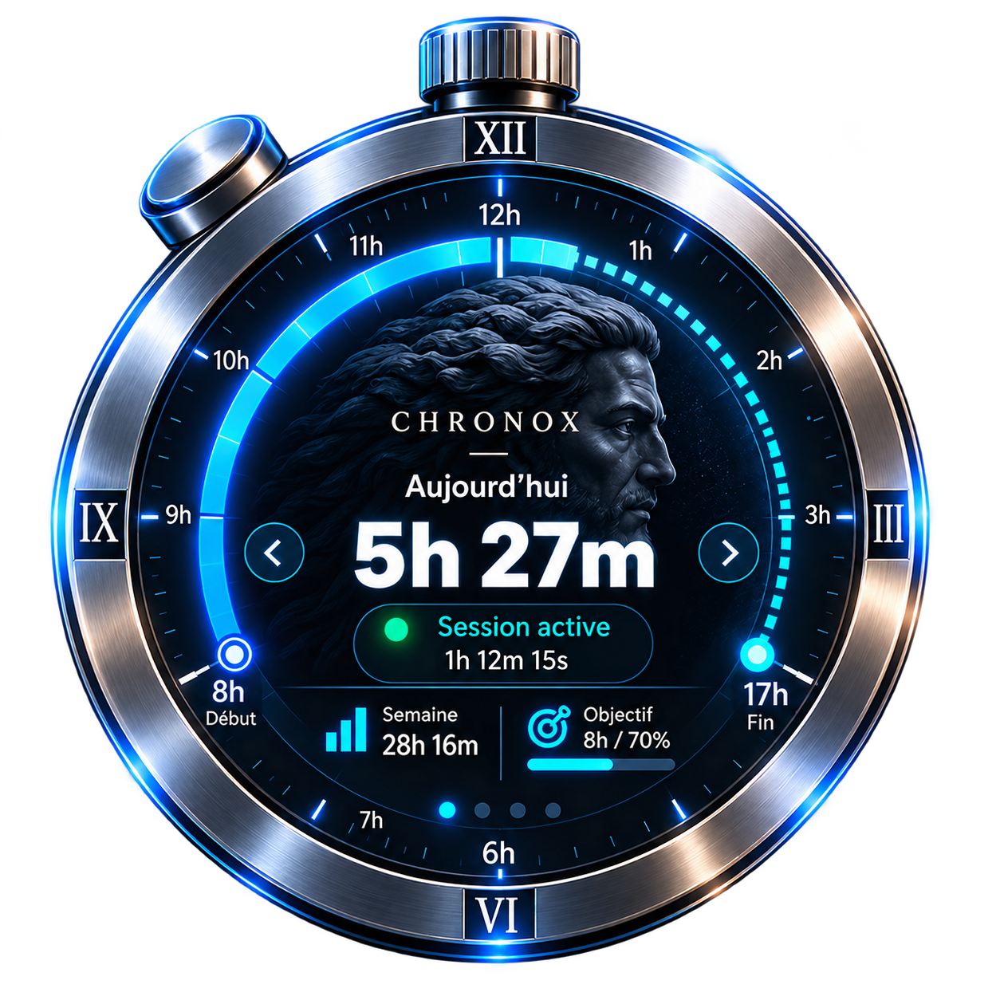

# Chronox V0.4 — spécification de l’interface

## Statut et périmètre

Cette spécification formalise la cible visuelle et fonctionnelle proposée pour
l’interface V0.4. La référence artistique ci-dessous a été sélectionnée. Le
prototype P1 natif est maintenant implémenté ; les ressources et le rendu
restent expérimentaux et doivent être validés en conditions réelles.

Les éléments du prototype P1 sont décrits comme **implémentés** ; les
fonctionnalités V0.4 restantes sont **proposées** ou **à valider**. La
spécification ne constitue pas un engagement de livraison de la version finale.

La spécification technique du suivi et des données reste celle de la
[spécification V0](./SPEC.md). Cette interface ne change ni le moteur de suivi,
ni les règles de comptabilisation, ni le schéma SQLite.

## Référence artistique

Copie de travail : [`assets/references/chronox-widget-reference.png`](../assets/references/chronox-widget-reference.png).
Le fichier téléchargé original est conservé hors du dépôt. SHA-256 de la copie :
`6435987CE01D83F2F03353C7B2881CA927C5B014747D29EF901E29DC3FA935AF`.

Cette image est une **référence artistique**, pas une ressource de production
définitive. Son filigrane, ses textes, chiffres, proportions et détails ne
doivent pas être incorporés tels quels dans l’application. Les ressources
finales, leur licence, leur transparence et leur optimisation devront être
validées séparément.

## Premières ressources du widget — provisoires

Les originaux ont été conservés dans Downloads. Les copies ci-dessous ont été
importées sans conversion ni retouche ; leurs empreintes SHA-256 correspondent
aux fichiers sources.

| Couche | Ressource | Source conservée | Dimensions / format | Poids | SHA-256 |
|---|---|---|---|---:|---|
| Coque métallique | [`assets/ui/chronox-shell.png`](../assets/ui/chronox-shell.png) | `Image ChatGPT 31 oct. 2026, 13_11_34-1.png` | 1254 × 1254, PNG RGBA 8 bits | 1 119 398 octets (1,07 MiB) | `D644CF982EE0DC820F840C4FAD03CE2AC5899A69C3C0B964E38235044771C58D` |
| Fond du cadran | [`assets/ui/chronox-dial-background.png`](../assets/ui/chronox-dial-background.png) | `Image ChatGPT 31 oct. 2026, 13_11_35-2.png` | 1254 × 1254, PNG RGBA 8 bits | 1 775 427 octets (1,69 MiB) | `7A73E864785C59ADBE419830DA783407935A760CF819AB95FD3307A552A66A5C` |

Les deux images possèdent un véritable canal alpha. Sur la coque, environ
68,39 % des pixels ont un alpha nul et 31,56 % un alpha partiel ; les zones
transparentes extérieures et l’ouverture centrale ne sont pas un fond noir
opaque. Un halo bleu et gris à faible opacité entoure la coque ; il est visible
sur fond clair et doit être vérifié sur plusieurs fonds lors du prototype.
Quelques pixels entièrement transparents contiennent des valeurs RGB
résiduelles ; le décodage et le rééchantillonnage doivent respecter l’alpha
pour éviter une frange.

Le fond de cadran a également une transparence réelle : environ 41,03 % de
pixels transparents, 58,89 % à alpha partiel et 0,08 % opaques. Son disque
intérieur est une illustration sombre de Chronos, non un aplat noir opaque.
L’aperçu sur fond clair ne révèle pas de fond noir ajouté ni de bord rectangulaire
opaque. La séparation des deux ressources est cohérente avec l’identité visuelle
attendue.

Ces fichiers sont **provisoires, pas prêts pour la production**. Leur poids
cumulé est d’environ 2,76 MiB avant toute optimisation. La provenance et les
droits d’utilisation des images, le rendu des halos sur fonds variés, les
artefacts éventuels après redimensionnement et la qualité finale aux tailles
réelles restent à valider. Ne pas supprimer le halo ni convertir du noir en
transparence automatiquement ; toute retouche nécessiterait une validation
visuelle explicite.

### Composition proposée

- Utiliser un même repère carré de 1254 × 1254 pour les deux couches, centrées
  sur le widget. Dessiner le fond du cadran dans l’ouverture, puis la coque
  transparente à sa taille complète pour masquer proprement les bords et
  former le cadre.
- Bien que les canevas aient les mêmes dimensions, le disque visible du fond
  (environ 1090 px de diamètre à alpha élevé) est plus large que l’ouverture
  mesurée de la coque (environ 827 px sur la ligne centrale). Une superposition
  temporaire suggère de dessiner le fond à environ **80 %** de l’échelle de la
  coque, centré, puis de laisser la coque recouvrir le bord. C’est une valeur
  initiale de prototype, pas une constante validée ; ajuster taille et position
  à l’œil sur l’ensemble de la circonférence pour éviter un liseré clair ou un
  recouvrement visible du métal.
- À cette échelle, le rectangle du fond serait d’environ 176 px pour une coque
  de 220 px et 280 px pour une coque de 350 px, avant ajustement DPI. Conserver
  le ratio d’aspect ; ne pas étirer indépendamment largeur et hauteur.
- Rendre par-dessus une troisième couche entièrement dynamique : compteurs,
  textes, graduations, anneaux, progression, état de session et commandes de
  navigation. Ces éléments et leurs zones d’interaction restent natifs ; ils
  ne doivent pas être aplatis dans les PNG.
- Clipper les éléments du cadran à son ouverture. Les boutons natifs peuvent
  être dessinés au-dessus des couches statiques, avec des zones de hit-test
  Win32 distinctes de leur apparence.
- Décoder les PNG avec une voie Windows respectant leur alpha (par exemple
  WIC), composer avec alpha prémultiplié correctement et rééchantillonner avec
  un filtre de bonne qualité. Mettre en cache les bitmaps à l’échelle utile ;
  les reconstruire seulement au changement de taille/DPI, pas à chaque rendu.

## Prototype P1 — état d’implémentation

Implémenté dans le prototype Windows :

- fenêtre widget native transparente, positionnée en bas à droite de la zone de
  travail principale, avec une coque dont le diamètre visible est proche de
  220 px à 100 % DPI ;
- coque et fond Chronos chargés depuis `assets\ui`, avec le fond centré à 80 %
  et la coque dessinée par-dessus ;
- rendu per-pixel alpha avec WIC, Direct2D et DirectWrite ; les bitmaps sont
  réduits à l’échelle d’affichage et gardés en cache jusqu’au changement DPI ou
  au basculement entre les états déployé et rétracté ;
- cumul mesuré du jour, état actif/en pause et durée de suivi depuis le
  lancement courant ;
- languette de rétraction/déploiement et déplacement de la fenêtre par
  glisser-déposer ;
- icône de notification avec commandes afficher/masquer, épingler au premier
  plan et quitter.

Le rafraîchissement à la seconde est limité au widget visible et déployé tant
que le moteur compte. Le code n’ajoute pas de thread applicatif ni de boucle
d’attente active ; les transitions continuent d’être reçues par la fenêtre de
monitoring existante, et la sauvegarde SQLite reste à son rythme d’une minute.
Les bibliothèques Windows peuvent créer des threads internes, comme le montre
le comptage du processus dans le [bilan de performance](./PERFORMANCE.md).

Non inclus dans P1 : dashboard, navigation entre vues, arcs horaires, plage
configurable, persistance des préférences et suivi applicatif. La languette et
les ressources sont un prototype ; le positionnement multi-écrans, les DPI
mixtes, l’accessibilité et l’affichage en plein écran restent à valider.

Les mesures de consommation et les résultats de compilation Windows sont
consignés dans le [protocole de performance](./PERFORMANCE.md) après leur
exécution ; aucun résultat n’est présumé dans cette spécification.

## Identité graphique cible

- Chronomètre tridimensionnel premium, en titane argenté brossé.
- Cadran sombre, avec un relief de Chronos en arrière-plan.
- Bouton mécanique compact en haut à gauche et couronne supérieure discrète.
- Éclairage bleu électrique, traits lumineux et accents cyan.
- Contour extérieur transparent autour du boîtier afin de laisser voir le
  bureau ; la gestion de l’alpha et des effets lumineux reste à valider sur
  Windows.

La cible reprend le langage visuel de l’image, sans figer la direction
artistique au-delà de cette référence ni imposer ses détails décoratifs.

## Cadran et informations

### Échelle et horaires

- Cadran circulaire de **12 heures**, avec les douze divisions principales et
  des subdivisions plus fines.
- Les valeurs représentent les heures de la journée au format local sur
  24 heures. Les positions du cadran sont cycliques : par exemple, 17 h se
  place à la position 5 h. Les libellés de début et de fin gardent leur valeur
  non ambiguë, par exemple `08 h — Début` et `17 h — Fin`.
- Plage de suivi configurable ; valeur initiale proposée : **08:00–17:00**,
  soit neuf heures. Le fuseau local et les changements d’heure doivent être
  cohérents avec les limites calendaires du moteur existant.
- Le comportement de plages traversant minuit et celui d’une heure inexistante
  ou répétée lors d’un changement d’heure restent à spécifier avant
  implémentation.

### Anneaux et repères

- Le temps écoulé dans la plage configurée est représenté par un arc bleu
  continu.
- Le temps restant dans cette plage est représenté par des pointillés cyan.
- Les heures hors de la plage sont grisées.
- Le début et la fin sont repérés et libellés explicitement.
- Ces arcs expriment la progression dans la plage horaire configurée ; ils ne
  constituent pas une mesure de travail effectif ni une preuve d’activité.

### Contenu central et navigation

- Afficher au centre le temps du jour, avec un libellé précisant qu’il s’agit
  du temps mesuré par Chronox.
- Afficher distinctement l’état de session (active ou arrêtée) et la durée de
  la période courante lorsque le suivi est actif.
- Permettre de naviguer entre plusieurs vues au moyen de flèches. Le contenu
  précis et l’ordre des vues restent à confirmer par prototype.
- La distinction entre la progression horaire des anneaux et le cumul réel
  mesuré par Chronox doit rester compréhensible dans chaque vue.

Le moteur actuel mesure seulement le temps pendant lequel la session Windows
est déverrouillée et le PC éveillé simultanément, pendant l’exécution de
Chronox. Ce temps ne correspond pas nécessairement à du temps de travail
effectif. Le widget ne doit pas présenter une durée mesurée comme preuve de
présence humaine continue ou de productivité.

## États et fenêtres

Les tailles ci-dessous sont des dimensions indicatives à l’échelle Windows
100 % ; elles devront être vérifiées sur plusieurs résolutions et facteurs
DPI.

| État | Présentation cible |
|---|---|
| Rétracté | Languette discrète ancrée au bord droit de l’écran ; elle donne accès au widget sans masquer inutilement le bureau. |
| Compact | Cadran d’environ 220 px, affichage essentiel du temps du jour et de l’état de session. |
| Agrandi | Cadran d’environ 350 px, davantage d’informations et navigation entre vues. |
| Dashboard | Fenêtre indépendante avec statistiques détaillées et historique disponible. |

Le dashboard V0.4 peut présenter les cumuls et périodes déjà fournis par le
moteur. Le suivi des applications au premier plan n’est pas implémenté et ne
fait pas partie de cette interface V0.4 ; aucune répartition applicative ne
doit être simulée comme une donnée réelle.

Les gestes exacts de déploiement, repli, redimensionnement, fermeture et retour
du dashboard au widget restent à confirmer durant le prototypage.

## Intégration Windows

- Position initiale en bas à droite, au-dessus de la barre des tâches.
- Animation de déploiement depuis le bord droit ; elle doit rester courte,
  discrète et pouvoir être désactivée si nécessaire.
- Icône et commandes d’accès dans la zone de notification Windows.
- Option utilisateur pour afficher le widget au premier plan ; ce comportement
  ne doit pas être imposé par défaut sans validation.
- Gérer les déplacements entre écrans, les écrans aux résolutions ou facteurs
  DPI différents, les changements de configuration et la restauration d’une
  position devenue invalide.
- Définir un comportement non intrusif en plein écran, avec barre des tâches
  masquée ou affichée automatiquement.
- Mémoriser les états et préférences pertinents. Le format, l’emplacement, les
  règles de migration et le périmètre exact des préférences restent à décider.

## Architecture envisagée — à valider

Une approche native hybride est à prototyper :

- PNG ou WebP avec alpha pour les éléments 3D statiques ;
- Direct2D pour les anneaux, graduations, arcs et indicateurs ;
- DirectWrite pour les textes et compteurs ;
- Win32 pour les fenêtres, interactions, événements et zone de notification ;
- conservation du moteur C++20, des calculs calendaires et de la base SQLite
  existants.

Ce choix n’est pas une décision technique définitive. Un prototype devra
valider la composition des éléments, le rendu transparent, l’accessibilité, le
comportement DPI, la maintenance et les dépendances nécessaires sur une
installation Windows standard. Les vues devront consommer les données du
moteur sans déplacer la logique métier dans le code de rendu. Une actualisation
visuelle ne devra pas déclencher une écriture SQLite.

## Performance et stabilité

Objectifs à mesurer, sans résultat présumé :

- ne redessiner que lors d’un événement ou d’un changement de valeur affichée ;
- limiter les mises à jour périodiques au strict nécessaire lorsque le widget
  est visible ; suspendre les animations et le rendu inutile lorsqu’il est
  masqué ;
- ne réaliser aucun rendu 3D permanent ; privilégier des ressources statiques
  et un rendu 2D événementiel ;
- maintenir une faible consommation CPU au repos et éviter les écritures disque
  liées aux seules actualisations graphiques.

Le protocole de validation devra mesurer séparément, sur une version Release :

- CPU au repos, widget compact visible, widget masqué et dashboard ouvert ;
- mémoire privée/RAM et son évolution ;
- nombre de handles Win32 et de threads ;
- fréquence et volume des accès disque, ainsi que l’évolution de la base ;
- stabilité pendant plusieurs heures, avec navigation, verrouillage/réveil et
  changements d’écran/DPI lorsque le matériel le permet.

Aucun de ces résultats n’est revendiqué par cette spécification. Les essais
nécessitant une session interactive devront être exécutés sur un vrai PC
Windows et consignés séparément des tests automatisés.

## Points restant à valider

- Lisibilité et usage du cadran 12 h lorsque les valeurs sont des heures locales
  24 h, en particulier autour de minuit et lors des changements d’heure.
- Sens exact du temps central et des arcs, et compréhension de leur différence
  avec le temps de session réellement mesuré.
- Plages de suivi traversant minuit et traitement des heures DST ambiguës ou
  inexistantes.
- Contenu, ordre et interactions des vues accessibles par les flèches.
- Dimensions finales, accessibilité clavier, contraste, réduction des
  animations et comportement au premier plan.
- Persistance des préférences et stratégie pour plusieurs écrans.
- Faisabilité et coût de l’approche hybride, dépendances et mesures de
  performance sur une version Release.
